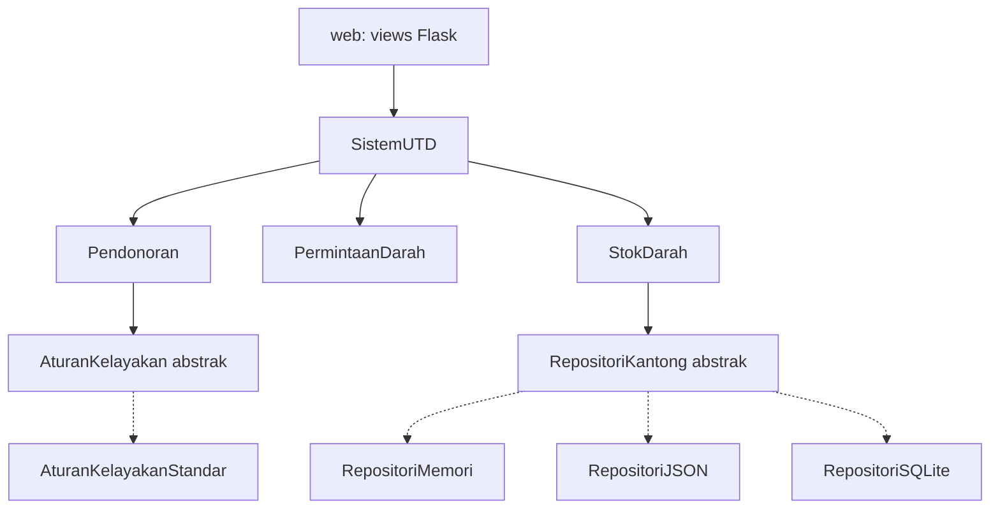

# Sistem Manajemen Donor dan Stok Kantong Darah

Proyek ISP132 Pemrograman Berorientasi Objek, Universitas Jambi. Kelompok 1.
Dibangun dengan Python dan Flask, memakai pendekatan OOP dan prinsip SOLID.

> Sistem ini adalah simulasi pembelajaran dengan data fiktif. Angka medis di `aturan/parameter.py`
> berstatus nilai demo sampai diverifikasi ke sumber resmi, sehingga tidak untuk keputusan klinis.

- Demo: https://sistem-bank-darah.vercel.app/
- Papan kerja: https://github.com/users/prideskai-rgb/projects/9
- Repositori: https://github.com/prideskai-rgb/Sistem_Bank_Darah

## Anggota

| Nama | NIM | Peran |
|---|---|---|
| Iqral Prideska | F1E125006 | Ketua, fondasi sistem, integrasi, SQLite, rilis |
| Kezia Anindhya Putri Lira | F1E125046 | Pendonoran, halaman Pendonoran dan Penelusuran |
| Fadhilah Zahra Putri | F1E125033 | PermintaanDarah (FEFO), halaman Stok dan Permintaan |
| Rizki Amalina Harahap | F1E125012 | Aturan kelayakan, parameter, halaman Parameter |

## Fitur

1. Registrasi dan validasi donor
2. Pemeriksaan kelayakan donor (usia, berat badan, jeda donor, hemoglobin, tekanan darah)
3. Pencatatan pendonoran yang menghasilkan kantong darah
4. Stok kantong darah dengan filter komponen
5. Pemilihan kantong dengan kedaluwarsa terdekat (FEFO)
6. Peringatan kantong hampir dan sudah kedaluwarsa
7. Permintaan darah dengan pencocokan golongan ABO dan Rhesus (status DIPENUHI, SEBAGIAN, TIDAK TERPENUHI)
8. Penelusuran kantong sampai ke donor
9. Halaman Parameter beserta status verifikasi

## Menjalankan (Windows PowerShell)

```
python -m venv venv
.\venv\Scripts\Activate.ps1
python -m pip install -r requirements-dev.txt
python -m flask --app app run --debug
python -m pytest -q
```

Buka http://127.0.0.1:5000. Tanpa pengaturan tambahan, data disimpan di memori dan kosong sampai
tombol "Reset data demo" ditekan.

## Pilihan penyimpanan data

| Variabel environment | Penyimpanan | Keterangan |
|---|---|---|
| (tidak ada) | Memori | Bawaan. Data hilang saat program berhenti. Dipakai di Vercel |
| `DATA_JSON` | Berkas JSON | Contoh: `$env:DATA_JSON = "data/utd.json"` |
| `DATA_SQLITE` | Database SQLite | Contoh: `$env:DATA_SQLITE = "data/utd.db"` |
| `ISI_DATA_DEMO=1` | Mengisi data demo | Hanya jika data masih kosong |

Jika `DATA_SQLITE` dan `DATA_JSON` sama-sama diisi, yang dipakai adalah SQLite.
Di Vercel, berkas tidak permanen, sehingga demo online memakai data memori.

## Struktur

```
models/      entitas (Donor, KantongDarah, KomponenDarah, GolonganDarah, enum)
aturan/      aturan kelayakan dan parameter
repositori/  kontrak penyimpanan, memori, JSON, SQLite
services/    logika (Pendonoran, StokDarah, PermintaanDarah, SistemUTD)
web/         halaman Flask
tests/       tes pytest
docs/        dokumentasi dan diagram
```

## Peta SOLID

| Prinsip | Lokasi |
|---|---|
| SRP | Satu class satu tugas: `StokDarah`, `Pendonoran`, `PermintaanDarah` |
| OCP | `KOMPONEN_TERSEDIA`, subclass `AturanKelayakan` baru, dan `RepositoriSQLite` ditambahkan tanpa mengubah layanan |
| LSP | Semua `KomponenDarah`, `AturanKelayakan`, dan repositori dapat saling menggantikan |
| ISP | Tiga kontrak kecil di `repositori/kontrak.py` |
| DIP | Layanan bergantung pada abstraksi dan menerima aturan serta repositori dari luar |

## Arsitektur



Penjelasan lengkap ada di [docs/arsitektur.md](docs/arsitektur.md).

## Pengujian dan CI

Setiap Pull Request menjalankan `python -m pytest -q` lewat GitHub Actions (Python 3.12).
Cabang `main` dilindungi: wajib Pull Request, 1 persetujuan, dan status tes hijau.