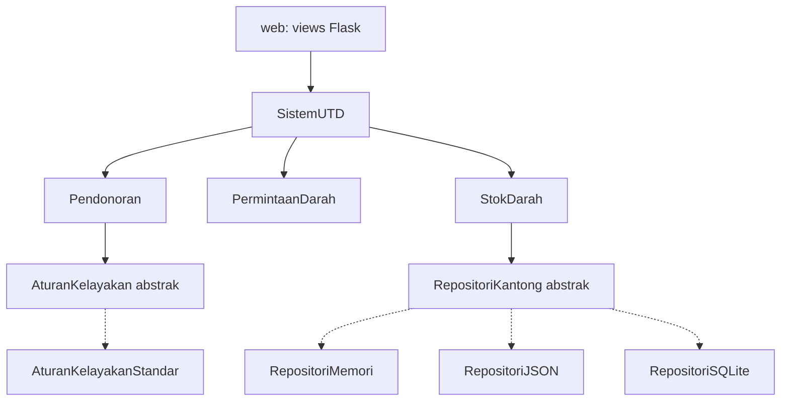

# Arsitektur Sistem

Sistem dibagi menjadi lima lapisan. Panah ketergantungan selalu mengarah ke bawah, dan lapisan
bawah tidak mengenal lapisan di atasnya.

| Lapisan | Folder | Tugas |
|---|---|---|
| 1. Web | `web/` | Menerima permintaan browser dan menampilkan halaman. Hanya memanggil `SistemUTD` |
| 2. Layanan | `services/` | `SistemUTD` (pintu masuk), `Pendonoran`, `StokDarah`, `PermintaanDarah` |
| 3. Model dan aturan | `models/`, `aturan/` | Entitas, aturan kelayakan, dan parameter |
| 4. Kontrak repositori | `repositori/kontrak.py` | Tiga kontrak kecil: donor, pendonoran, kantong |
| 5. Penyimpanan | `repositori/` | `RepositoriMemori`, `RepositoriJSON`, `RepositoriSQLite` |

## Alur permintaan darah

1. `web/views_permintaan.py` memanggil `SistemUTD.ajukan_permintaan()`.
2. `SistemUTD` membuat `PermintaanDarah` dan memanggil `penuhi(stok)`.
3. `StokDarah` mengambil kantong layak pakai dari repositori, mengurutkan dari kedaluwarsa terdekat (FEFO),
   lalu bertanya ke setiap kantong apakah cocok.
4. Kantong bertanya ke komponennya (`SelDarahMerah` atau `Plasma`) karena aturan kecocokan berbeda tiap komponen.
5. Kantong yang terpilih ditandai terpakai dan disimpan kembali. Status akhir: DIPENUHI, SEBAGIAN, atau TIDAK_TERPENUHI.

## Pemilihan penyimpanan

`rakit_sistem()` di `web/__init__.py` memilih repositori dari environment: `DATA_SQLITE`, lalu `DATA_JSON`,
lalu memori. Layanan tidak tahu penyimpanan mana yang dipakai (DIP), sehingga repositori baru cukup berupa
satu class baru (OCP).

## Diagram

Lihat folder `docs/diagram/`: class diagram, flowchart pendonoran, flowchart permintaan, dan arsitektur lapisan.

